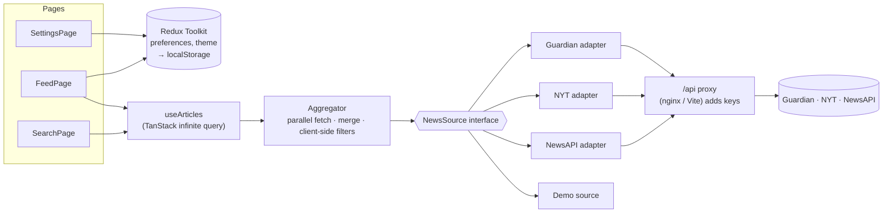

# Newsroom: news aggregator

A news aggregator built with React and TypeScript. It pulls articles from **The Guardian**,
**The New York Times** and **NewsAPI.org** and shows them in one clean, responsive feed.

- **Search and filters:** search by keyword and filter by date range, category and source. The
  filters live in the URL, so a search can be shared and the back button works.
- **Personalised feed:** pick preferred sources and topics, and follow authors. You can follow an
  author straight from any article by clicking their name.
- **Mobile-first:** bottom tab bar and a bottom-sheet filter drawer on phones, a sidebar on
  desktop. Light, dark and system themes.
- **Resilient:** if one source fails or hits its rate limit, the others are still shown together
  with a notice. With no API keys at all, the app runs in **demo mode** on a recorded sample.

## Contents

- [Quick start (Docker)](#quick-start-docker)
- [Getting API keys](#getting-api-keys)
- [Local development](#local-development)
- [Architecture](#architecture)
- [Design principles in the code](#design-principles-in-the-code)
- [Testing](#testing)
- [Known limitations and trade-offs](#known-limitations-and-trade-offs)

## Quick start (Docker)

Requirements: Docker with Compose v2.

```bash
cp .env.example .env      # optional: add API keys, see below
docker compose up --build
```

Open **http://localhost:8080**.

- **Without keys** the app starts in **demo mode**: a banner explains it, and every feature
  (search, filters, feed, following authors) works on a recorded sample of about 240 real articles.
- **With keys** the news is live. You can configure any subset of the keys; sources without a key
  are disabled.

The image build runs lint, format check, type check and the whole test suite, so a broken commit
never produces an image. To use another port, run `PORT=3000 docker compose up --build`.

## Getting API keys

All three keys are free and take a couple of minutes to get. Put them in `.env`:

| Variable           | Where to get it                                                                                         |
| ------------------ | ------------------------------------------------------------------------------------------------------- |
| `GUARDIAN_API_KEY` | [open-platform.theguardian.com/access](https://open-platform.theguardian.com/access): "Developer key"   |
| `NYT_API_KEY`      | [developer.nytimes.com](https://developer.nytimes.com): create an app and enable **Article Search API** |
| `NEWSAPI_API_KEY`  | [newsapi.org/register](https://newsapi.org/register)                                                    |

**The keys never reach the browser.** The app only calls its own `/api/<source>/…` endpoints, and a
proxy attaches the key before forwarding the request:

- in Docker: nginx ([`docker/nginx/default.conf.template`](docker/nginx/default.conf.template));
- in development: a Vite plugin ([`server/vite-api-proxy.ts`](server/vite-api-proxy.ts)).

`GET /api/config` tells the app which sources are configured, without exposing the keys. The proxy
also solves CORS: NewsAPI's free plan rejects browser requests from anything but `localhost`.

## Local development

Requires Node **20.19+** (`.nvmrc` pins 24, so `nvm use` is enough).

```bash
npm install
npm run dev               # http://localhost:5173, reads keys from .env
```

| Script                | What it does                                                            |
| --------------------- | ----------------------------------------------------------------------- |
| `npm run dev`         | Dev server with the API proxy                                           |
| `npm run build`       | Type check and production build                                         |
| `npm run preview`     | Serves the production build (with the proxy)                            |
| `npm test`            | Runs all tests once (`test:watch`, `test:coverage` also exist)          |
| `npm run check`       | Lint, format check, type check and tests (also run by the Docker build) |
| `npm run lint`        | [oxlint](https://oxc.rs) (React, hooks, a11y, import and Vitest rules)  |
| `npm run format`      | Prettier, including Tailwind class sorting                              |
| `npm run demo:record` | Re-records the demo-mode sample from the live APIs (needs keys)         |

## Architecture

**Stack:** React 19, TypeScript (strict), Vite, Tailwind CSS 4, TanStack Query (server state),
Redux Toolkit (client state), React Router, Zod, Vitest, Testing Library and MSW.



### How a request flows

1. **Pages** turn UI state into `NewsFilters`. The search page reads them from the URL, the feed
   page from the user's preferences in Redux.
2. **`useArticles`** ([`features/articles/use-articles.ts`](src/features/articles/use-articles.ts))
   normalises the filters (so equal filters share a cache entry) and runs a TanStack infinite query.
3. **The aggregator** ([`features/articles/aggregator.ts`](src/features/articles/aggregator.ts))
   calls every selected source in parallel, each with its own page cursor. It applies the filters
   an API could not apply itself, sorts newest first and reports failing sources without failing
   the page.
4. **Source adapters** ([`sources/`](src/sources)) translate the query into each API's parameters,
   validate the response with Zod and normalise it into one `Article` model.

### Folder structure

```
src/
├── domain/      Article, categories, the NewsSource contract, query matching (no React, no I/O)
├── sources/     One adapter per API + demo source, registry, shared HTTP/error helpers
├── features/    articles (aggregator, hooks, feed UI), search, preferences, theme
├── pages/       Route components: feed, search, settings, 404
├── shared/      Generic UI (Button, ChipGroup, Drawer…) and helpers
├── app/         Providers, router, Redux store, QueryClient
└── test/        MSW server, render helpers, factories
server/          Dev/preview API proxy (Vite plugin)
docker/          nginx config and entrypoint script
scripts/         Demo data recorder
```

`app` wires everything together. Otherwise dependencies point downwards:
`pages → features → sources → domain`. Shared code is used by any layer, and the domain layer
depends on nothing.

### Key decisions

- **Server state vs client state.** Articles and the source configuration are server state:
  caching, infinite pagination, cancellation and retries are what TanStack Query does best. User
  preferences and the theme are client state and live in Redux Toolkit. They are persisted to
  `localStorage` by listener middleware and validated with Zod when loaded.
- **Adapters behind one interface.** Each API has very different capabilities. Every adapter does
  what its API supports natively, for example Guardian contributor tags for authors, one NYT
  request per author, and NewsAPI's `"A" OR "B"`. The aggregator then guarantees the result with a
  shared matcher.
- **Partial failure is normal.** A rate-limited or failing source is reported and dropped from
  later pages, so infinite scroll never hammers it. Only when every source fails does the feed
  show an error with a retry button.
- **Quota-aware by default.** Responses are cached for 5 minutes, there is no refetch on window
  focus and no retry on HTTP 429. Infinite scroll loads the next page automatically only if the
  previous page added articles.
- **URL as state for search**, Redux for preferences, local component state for everything else.
- **Accessibility.** Semantic landmarks and headings, a skip link, a native `<dialog>` for the
  drawer, native radio inputs, `aria-pressed` toggles, visible focus, a live region for results
  and `prefers-reduced-motion` support.

## Design principles in the code

**SOLID**

- **Single responsibility:** each adapter only translates one API. The aggregator only merges.
  `fetchJson` only does HTTP plus validation. Every UI state of a feed (loading, error, empty,
  partial failure) is rendered by one component, `ArticleFeed`.
- **Open/closed:** to add a source, implement `NewsSource` and register it in
  [`sources/registry.ts`](src/sources/registry.ts). Nothing else changes. Demo mode proves it: it is
  just another `NewsSource` implementation, and the aggregator, hooks and UI are unaware of it.
- **Liskov substitution:** live and demo sources are interchangeable everywhere, and fake sources
  in the aggregator tests are too.
- **Interface segregation:** components get narrow props. For example, `ArticleCard` receives an
  optional `AuthorFollowing` capability instead of the whole store.
- **Dependency inversion:** the aggregator receives its sources as a parameter, and the UI depends
  on the `NewsSource` abstraction, not on concrete APIs. The card does not know about Redux: pages
  wire the store in.

**DRY:** one source table drives both proxies (`server/api-sources.ts`, mirrored by the nginx
template), there is one matcher for client-side filtering, one `mergePages` for per-category and
per-author requests, and shared option builders for the search and settings pages.

**KISS:**

- no global UI state that the URL or a component can hold;
- no `redux-persist`: a small listener middleware does the job;
- per-page sorting instead of a cross-source k-way merge (see the trade-offs below);
- native platform features (`<dialog>`, radio inputs, `Intl`) instead of extra dependencies.

## Testing

```bash
npm test                  # about 190 tests, a few seconds
npm run test:coverage     # line coverage above 99%
```

- **Adapters** are tested against fixtures recorded from the real APIs, plus edge cases (HTML in
  summaries, `docs: null`, `[Removed]` placeholders, malformed payloads, 429s).
- **The aggregator** is tested with fake sources, with no network: merging, cursors, partial
  failure and cancellation.
- **Pages** are integration-tested on the real routes, adapters and store, with the network mocked
  by MSW. Unhandled requests fail the test, which also proves that disabled sources are never
  called.
- **Hooks and components** cover debounce, infinite scroll, the drawer, theme switching,
  persistence and accessibility roles.

Every stage was also checked by hand in a real browser (desktop and 375 px, light and dark) and in
Docker.

## Known limitations and trade-offs

- **NewsAPI free (developer) plan:**
  - at most 100 results per query;
  - articles are delayed by about 24 hours;
  - categories exist only for top headlines, which have no date filter (the date range is then
    applied client-side);
  - no equivalent for _World_ or _Politics_, so NewsAPI is skipped for those categories.
- **NYT:**
  - 5 requests per minute; with several sources and pages you can see the "request limit reached"
    notice;
  - byline filtering no longer works in the 2025 Article Search API, so authors are searched by
    name and matched client-side;
  - the number of followed authors is capped at 5 because each one costs an NYT request.
- **Ordering across sources is per page.** Each "page" contains one page from every source, sorted
  newest first. A strict global order would need buffering and a k-way merge across sources: more
  complexity for little visible gain in a news feed.
- **Authors** are matched by name. Name variants (initials, middle names) can be missed.
- **Demo mode** turns on only when _no_ key is configured. Its sample is fixed in time, so the
  dates age (`npm run demo:record` refreshes it).
- Preferences are stored per browser (`localStorage`). There are no accounts and no sync.
