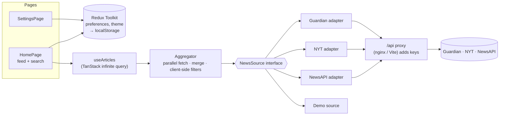

# Newsroom: news aggregator

A news aggregator built with React and TypeScript. It pulls articles from **The Guardian**,
**The New York Times** and **NewsAPI.org** and shows them in one clean, responsive feed.

- **One home page for feed and search:** the personalised feed with a search box and a
  **Filters** button on top. As soon as you type or pick a filter, the same page shows results;
  Back or "Back to my feed" returns to the feed in one step.
- **Search and filters:** search all news by keyword and filter by date range, topic, source and
  author. Applied filters are shown as removable chips with the article count. "Use my sources &
  topics" applies your feed preferences in one click. Sort by newest or most relevant. Everything
  lives in the URL (`/?q=climate&category=science`), so a search can be shared.
- **Personalised feed:** pick preferred sources and topics, and follow authors (their articles show
  from every source).
- **Article preview:** clicking an article opens a side panel (a bottom sheet on phones) with the
  full summary and its authors, each with a **Follow** button. It also links to more articles by the
  same author, on the same topic or from the same source, and to the original article. Cmd/Ctrl-click
  still opens the original in a new tab. An author filter doubles as an author page
  (`/?author=Fiona+Harvey`) with its own Follow button.
- **Mobile-first:** bottom tab bar and a bottom-sheet filter drawer on phones, a sidebar on
  desktop. Light, dark and system themes.
- **Resilient:** if one source fails or hits its rate limit, the others are still shown together
  with a notice. With no API keys at all, the app runs in **demo mode** on a recorded sample.

## Contents

- [Quick start (Docker)](#quick-start-docker)
- [Getting API keys](#getting-api-keys)
- [Local development](#local-development)
- [Architecture](#architecture)
- [Design principles in the code](#design-principles-in-the-code)
- [Testing](#testing)
- [Performance](#performance)
- [Where authentication and the cloud would fit](#where-authentication-and-the-cloud-would-fit)
- [Known limitations and trade-offs](#known-limitations-and-trade-offs)

## Quick start (Docker)

Requirements: Docker with Compose v2.

```bash
cp .env.example .env      # optional: add API keys, see below
docker compose up --build
```

Open **http://localhost:8080**.

- **Without keys** the app starts in **demo mode**: a banner explains it, and every feature
  (search, filters, feed, following authors) works on a recorded sample of about 240 real articles.
- **With keys** the news is live. You can configure any subset of the keys; sources without a key
  are disabled.

The image only type-checks and bundles the app, so it builds reliably on any machine. Lint and
tests run in CI on every push (`.github/workflows/ci.yml`), and in Docker on demand:
`docker build --target verify .`. To use another port, run `PORT=3000 docker compose up --build`.

The container also starts without network access (demo mode works offline): the proxy resolves
the API hosts per request.

## Getting API keys

All three keys are free and take a couple of minutes to get. Put them in `.env`:

| Variable           | Where to get it                                                                                         |
| ------------------ | ------------------------------------------------------------------------------------------------------- |
| `GUARDIAN_API_KEY` | [open-platform.theguardian.com/access](https://open-platform.theguardian.com/access): "Developer key"   |
| `NYT_API_KEY`      | [developer.nytimes.com](https://developer.nytimes.com): create an app and enable **Article Search API** |
| `NEWSAPI_API_KEY`  | [newsapi.org/register](https://newsapi.org/register)                                                    |

**The keys never reach the browser.** The app only calls its own `/api/<source>/…` endpoints, and a
proxy attaches the key before forwarding the request:

- in Docker: nginx ([`docker/nginx/default.conf.template`](docker/nginx/default.conf.template));
- in development: a Vite plugin ([`server/vite-api-proxy.ts`](server/vite-api-proxy.ts)).

`GET /api/config` tells the app which sources are configured, without exposing the keys. The proxy
also solves CORS: NewsAPI's free plan rejects browser requests from anything but `localhost`.

## Local development

Requires Node **20.19+** for the app (`.nvmrc` pins 24, so `nvm use` is enough); `npm run
demo:record` runs a TypeScript script directly and needs Node 22.18+.

```bash
npm install
npm run dev               # http://localhost:5173, reads keys from .env
```

| Script                | What it does                                                           |
| --------------------- | ---------------------------------------------------------------------- |
| `npm run dev`         | Dev server with the API proxy                                          |
| `npm run build`       | Type check and production build                                        |
| `npm run preview`     | Serves the production build (with the proxy)                           |
| `npm test`            | Runs all tests once (`test:watch`, `test:coverage` also exist)         |
| `npm run check`       | Lint, format check, type check and tests (what CI runs)                |
| `npm run lint`        | [oxlint](https://oxc.rs) (React, hooks, a11y, import and Vitest rules) |
| `npm run format`      | Prettier, including Tailwind class sorting                             |
| `npm run demo:record` | Re-records the demo-mode sample from the live APIs (needs keys)        |

## Architecture

**Stack:** React 19, TypeScript (strict), Vite, Tailwind CSS 4, TanStack Query (server state),
Redux Toolkit (client state), React Router, Zod, Vitest, Testing Library and MSW.



### How a request flows

1. **The home page** turns UI state into `NewsFilters`: from the URL when searching, from the
   user's preferences in Redux otherwise.
2. **`useArticles`** ([`features/articles/use-articles.ts`](src/features/articles/use-articles.ts))
   normalises the filters (so equal filters share a cache entry) and runs a TanStack infinite query.
3. **The aggregator** ([`features/articles/aggregator.ts`](src/features/articles/aggregator.ts))
   calls every selected source in parallel, each with its own page cursor. It applies the filters
   an API could not apply itself, sorts newest first and reports failing sources without failing
   the page.
4. **Source adapters** ([`sources/`](src/sources)) translate the query into each API's parameters,
   validate the response with Zod and normalise it into one `Article` model.

### Folder structure

```
src/
├── domain/      Article, categories, the NewsSource contract, query matching (no React, no I/O)
├── sources/     One adapter per API + demo source, registry, shared HTTP/error helpers
├── features/    articles (aggregator, hooks, feed UI), search, preferences, theme
├── pages/       Route components: home (feed + search views), settings, 404
├── shared/      Generic UI (Button, ChipGroup, Drawer…) and helpers
├── app/         Providers, router, Redux store, QueryClient
└── test/        MSW server, render helpers, factories
server/          Dev/preview API proxy (Vite plugin)
docker/          nginx config and entrypoint script
scripts/         Demo data recorder
```

`app` wires everything together. Otherwise dependencies point downwards:
`pages → features → sources → domain`. Small generic helpers in `shared/` (e.g. text folding) are
used by any layer, including the domain; `oxlint`'s `import/no-cycle` keeps the graph acyclic.

### Key decisions

- **Feed and search on one page, with one rule: the feed is personalised (Settings), search
  covers all news with filters.** The assignment lists search and the personalised feed as
  separate features, not separate pages, so one page keeps search one tap away. Filters belong to
  search only, as in Google News: putting them on the feed too created overlapping layers (feed
  preferences, filters, a "search in my feed" switch) that a usability review found confusing.
  "Use my sources & topics" covers the "search within my feed" case explicitly. Entering search is
  one history step; refining it replaces that step, and leaving it steps back, so Back never loops
  between feed and results (links from an article preview carry the same history state). Search
  state stays in the URL, so results remain shareable.
- **Preview instead of an article page.** The APIs return snippets, not full text, so an article
  page would mostly repeat the card. Instead, a preview panel is the place for actions: read on
  the site, follow the authors, explore related articles. The previewed article is a snapshot kept
  in the history entry's state, so opening it makes no request, Back closes it, and it survives a
  reload. It isn't in the URL: NYT and NewsAPI have no stable article ids to link to.
- **Server state vs client state.** Articles and the source configuration are server state:
  caching, infinite pagination, cancellation and retries are what TanStack Query does best. User
  preferences and the theme are client state and live in Redux Toolkit. They are persisted to
  `localStorage` by listener middleware and validated with Zod when loaded.
- **Adapters behind one interface.** Each API has very different capabilities. Every adapter does
  what its API supports natively, for example Guardian contributor tags for authors, one NYT
  request per author, and NewsAPI's `"A" OR "B"`. The aggregator then guarantees the result with a
  shared matcher.
- **Partial failure is normal.** A rate-limited or failing source is reported and dropped from
  later pages, so infinite scroll never hammers it. Only when every source fails does the feed
  show an error with a retry button.
- **Quota-aware by default.** The proxy caches API responses for 5 minutes, shared by all
  readers. In the app, a feed is never refetched behind the reader's back (an infinite query would
  re-request every loaded page): it shows "Updated … ago · Refresh" and refreshes from the first
  page on request. No retry on HTTP 429, and infinite scroll loads the next page automatically only
  if the previous page added articles.
- **URL as state for search**, Redux for preferences, local component state for everything else.
- **Accessibility.** Semantic landmarks and headings, a skip link, a native `<dialog>` for the
  drawer, native radio inputs, `aria-pressed` toggles, visible focus, a live region for results
  and `prefers-reduced-motion` support.

## Design principles in the code

**SOLID**

- **Single responsibility:** each adapter translates one API (Guardian's also caches its
  name→contributor-tag lookups, NYT's remembers which authors ran out, both details of their
  APIs). The aggregator only merges; `fetchJson` only does HTTP plus validation. The home page is
  layout: its URL and history model lives in
  [`useSearchNavigation`](src/features/search/use-search-navigation.ts), tested on its own.
- **Open/closed:** on the client, a source is an adapter implementing `NewsSource` plus an entry in
  [`sources/registry.ts`](src/sources/registry.ts) and `SOURCE_IDS`; the aggregator, hooks and UI
  don't change. Demo mode proves it: it's just another `NewsSource` implementation. The
  infrastructure is a separate, honest list: the proxy table, the nginx template and the
  container's env vars must each get the new source — a test fails if any of them is missed (see
  DRY).
- **Liskov substitution:** live, demo and test sources are interchangeable wherever a `NewsSource`
  is expected, and so are the real and fake `SourceCatalog`s.
- **Interface segregation:** small contracts — `NewsSource` is `id`, `name` and `search`;
  `ArticleCard` gets an optional `onOpen`, the preview an optional `AuthorFollowing` capability,
  never the whole store. `ArticleFeed` takes the feed hook's result because it renders every one
  of its states.
- **Dependency inversion:** hooks and components depend on the
  [`SourceCatalog`](src/domain/source-catalog.ts) abstraction (which sources exist, which are
  available, their names, where the config comes from), injected through React context. The
  concrete registry is chosen in one place, the composition root
  ([`app/AppProviders.tsx`](src/app/AppProviders.tsx)); tests inject a fake catalog. Likewise the
  aggregator receives its sources as a parameter, and pages wire the Redux store into
  store-agnostic components.

**DRY:** one source table (`server/api-sources.ts`: upstream, auth, allowed endpoints) drives the
dev proxy and the tests. nginx can't import TypeScript, so its template repeats those rules, and
[`server/source-config-sync.test.ts`](server/source-config-sync.test.ts) fails if the template,
entrypoint, compose file, Dockerfile, `.env.example` or the client's `SOURCE_IDS` drift from it.
In the app: one matcher for client-side filtering, one `mergePages` for per-category and
per-author requests, one `EmptyState` for every "nothing to show" screen, shared filter options
for search and settings.

**KISS:**

- no global UI state that the URL or a component can hold;
- no `redux-persist`: a small listener middleware does the job;
- per-page sorting instead of a cross-source k-way merge (see the trade-offs below);
- native platform features (`<dialog>`, `<select>`, radio inputs, `Intl`) instead of a component
  library: focus trapping, Esc, keyboard support and screen-reader semantics come from the browser.

Where it is _not_ the simplest possible code, on purpose:

- **Browser history** (`useSearchNavigation`): entering search pushes one entry, refining replaces
  it, leaving steps back. Plain push/replace would be shorter, but Back would then bounce between
  the feed and old results.
- **The article preview lives in history state**, so Back (and Android's back gesture) closes it
  and it survives a reload, without inventing article URLs that NYT and NewsAPI can't resolve.
- **Small data heuristics** in the adapters (NewsAPI "- Outlet" title suffixes, placeholder
  descriptions, relevance interleaving across sources): each is a few lines with tests, because
  the raw API data would otherwise show up as visible glitches.

## Testing

```bash
npm test                  # about 300 tests, a few seconds
npm run test:coverage     # line coverage ≈ 99%
```

- **Adapters** are tested against fixtures recorded from the real APIs, plus edge cases (HTML in
  summaries, `docs: null`, `[Removed]` placeholders, malformed payloads, 429s).
- **The aggregator** is tested with fake sources, with no network: merging, cursors, partial
  failure and cancellation.
- **Pages** are integration-tested on the real routes, adapters and store, with the network mocked
  by MSW. Unhandled requests fail the test, which also proves that disabled sources are never
  called.
- **Hooks and components** cover debounce, infinite scroll, the drawer, theme switching,
  persistence and accessibility roles.

- **Config checks** keep the source list in sync across the proxy, nginx and the container.

CI runs all of it plus a Docker smoke test (the image starts without keys and serves the app).
Every stage was also checked by hand in a real browser (desktop and 375 px, light and dark).

**Security of the proxy:** keys only exist in the container's environment; nginx forwards only the
endpoints the app uses (everything else under `/api` is 404), answers 503 itself for a source
without a key, verifies the APIs' TLS certificates, rate-limits `/api` per client, strips cookies
and browser origin headers, and sends a Content-Security-Policy (`script-src 'self'`: the pre-paint
theme script is a file, not inline) plus the usual security headers.

## Performance

Measured on the Docker image in demo mode (no third-party API latency), Lighthouse 12, mobile
emulation with its default simulated throttling, three runs:

| Metric                                       | Result           |
| -------------------------------------------- | ---------------- |
| Performance / Accessibility / Best practices | 84–89 / 100 / 96 |
| First Contentful Paint                       | 2.3–2.4 s        |
| Largest Contentful Paint                     | 3.3–4.0 s        |
| Total Blocking Time                          | 0–50 ms          |
| Cumulative Layout Shift                      | 0–0.04           |

JavaScript on first load is about **163 kB gzipped**, split for caching:

| Chunk                              | gzip   | Loaded         |
| ---------------------------------- | ------ | -------------- |
| `react` (React, React DOM, Router) | 100 kB | always         |
| `vendor` (Redux, TanStack, Zod…)   | 45 kB  | always         |
| app code                           | 17 kB  | always         |
| Settings page                      | 2 kB   | on navigation  |
| demo sample                        | 51 kB  | demo mode only |

The LCP element is the first article image. About 1 s of it is the SPA waterfall (JS, then
`/api/config` and the articles, then the image request) and about 1.8 s is downloading the
publisher's image on a throttled mobile connection. Loading the first row of images eagerly with
`fetchpriority="high"` is in place but didn't move the number measurably. What would: rendering
the first page on the server or preloading its data, and an image proxy/CDN that serves resized,
modern formats. Both are architecture changes beyond this assignment.

## Where authentication and the cloud would fit

Not built (the assignment has no accounts), but the architecture leaves clear places for them:

- **Accounts and synced preferences:** the nginx proxy grows into a small backend-for-frontend
  (BFF). Sign-in issues a session as an `httpOnly`, `Secure`, `SameSite` cookie (or a short-lived
  JWT plus a rotating refresh token kept in that cookie), never in `localStorage` where any XSS
  could read it. `fetchJson` would handle `401` by refreshing once and retrying; the Redux
  preferences slice would load from and save to the BFF instead of `localStorage`.
- **Scaling past free quotas:** instead of every request reaching the news APIs, a scheduled job
  ingests articles into a database with a search index, and the API (behind a CDN) serves the
  app. The `NewsSource` contract would get one more implementation for that API.
- **Deployment:** the image is stateless and configured by environment variables, so it runs as is
  on a container platform (e.g. Cloud Run, ECS, Kubernetes) with secrets from the platform's secret
  manager.

## Known limitations and trade-offs

- **API quotas on free plans are small.** Search-as-you-type waits for a 600 ms pause and two
  characters, the proxy shares cached responses for 5 minutes, and later pages skip exhausted
  sources — but heavy use can still hit the limits, shown as a per-source notice with a Retry
  button.
- **NewsAPI free (developer) plan:**
  - 100 requests per day, and at most 100 results per query;
  - articles are delayed by about 24 hours;
  - categories exist only for top headlines, which have no date filter (the date range is then
    applied client-side);
  - no equivalent for _World_ or _Politics_, so NewsAPI is skipped for those categories.
- **NYT:**
  - 5 requests per minute (and 500 per day); with several sources and pages you can see the
    "request limit reached" notice;
  - byline filtering no longer works in the 2025 Article Search API, so authors are searched by
    name and matched client-side;
  - the number of followed authors is capped at 5 because each one costs an NYT request.
- **Previews can't be shared by link** (see Key decisions). Share the original article instead.
- **"Most relevant" keeps each source's own ranking.** Relevance scores of different APIs aren't
  comparable, so results are interleaved: every source's best match, then every second-best, and so
  on. Top headlines (NewsAPI with a category) have no relevance order. In demo mode, a simple local
  score is used: title matches count more than summary matches.
- **Ordering across sources is per page.** Each "page" contains one page from every source, sorted
  newest first. A strict global order would need buffering and a k-way merge across sources: more
  complexity for little visible gain in a news feed.
- **Authors** are matched by name. Name variants (initials, middle names) can be missed.
- **Demo mode** turns on only when _no_ key is configured. Its sample is fixed in time, so the
  dates age (`npm run demo:record` refreshes it).
- Preferences are stored per browser (`localStorage`). There are no accounts and no sync, not even
  between open tabs.
- **Date filters use UTC days**, the convention of the APIs: late in the evening in the Americas,
  "today" can already be tomorrow's date in UTC.
- **Article images load from the publishers' servers**, which see the reader's IP address. An
  image proxy would avoid that (and help performance, see above).
